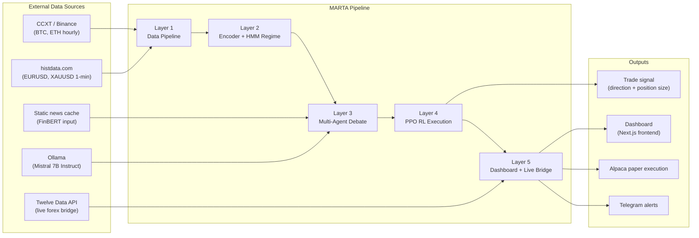
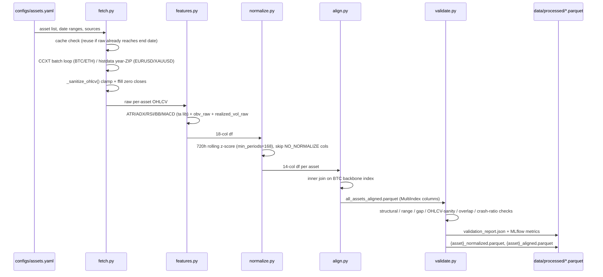
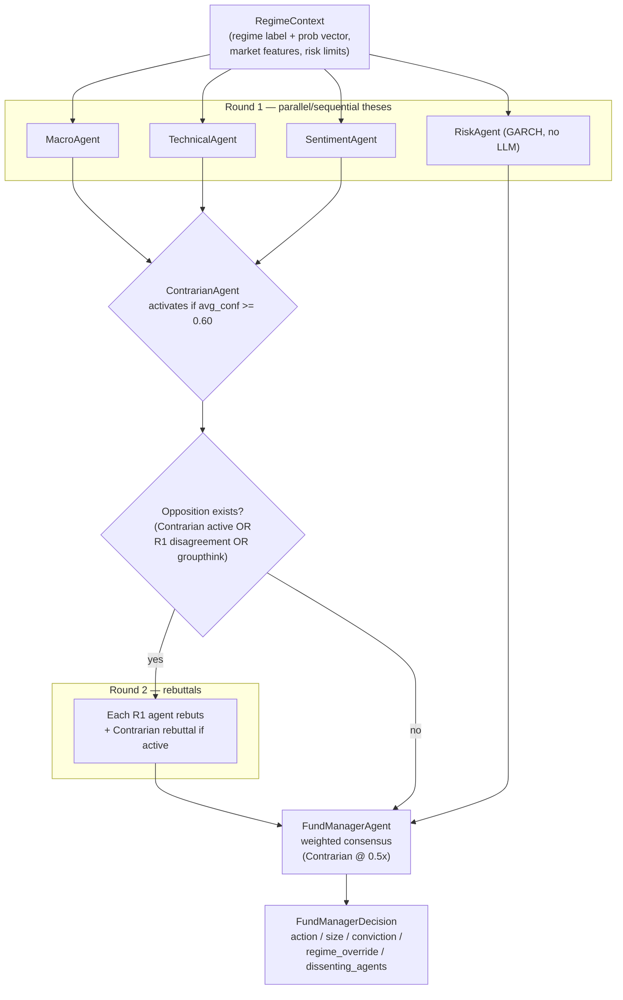
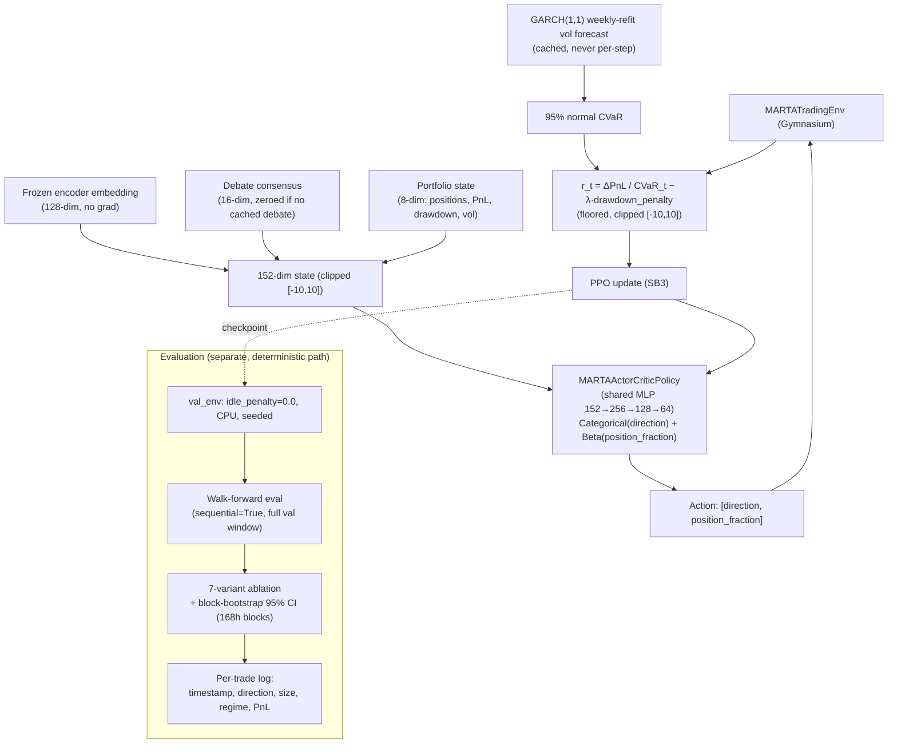
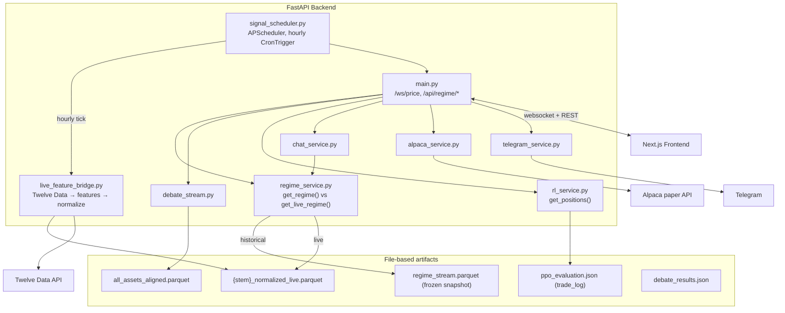
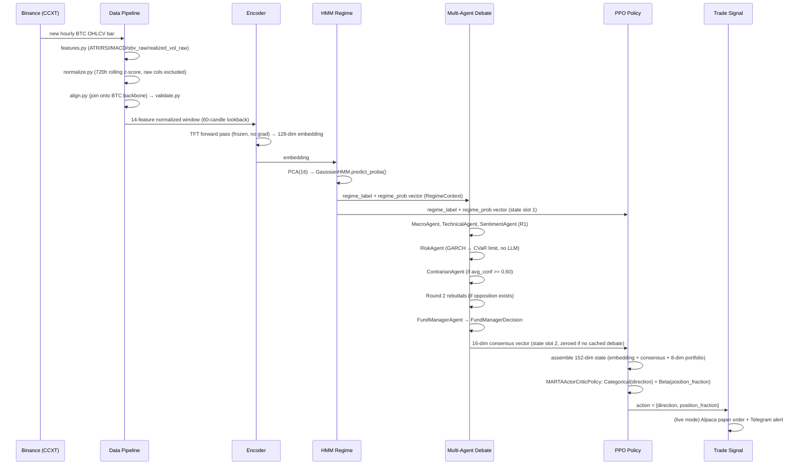
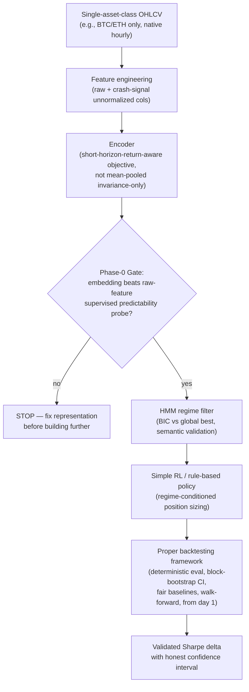

# MARTA — System Design & Architecture Document

**Multi-Layer Regime-Aware Trading Architecture with Representation Learning, Multi-Agent Debate, and RL Execution**

*Final-Year Engineering Project (PFE) — ESPRIT, Finance Specialty*

> **Update (2026-08-14):** the "Key finding" below (mean-pooling encoder discarding
> short-horizon signal) was the diagnosis at the time this document was written, framed as an
> open hypothesis. It has since been tested directly: four separate encoder retraining
> variants (different pooling, weaker augmentation, predictive positive pairs, false-negative
> exclusion) were each implemented, trained, and evaluated — **none beat raw, unlearned
> features on predictive power**, and the best variant was traced through the full downstream
> pipeline and found to produce a statistically incoherent regime detector. The project has
> since pivoted to a raw-feature baseline. See `docs/RESULTS_AND_METHODOLOGY.md` for the full,
> current account — read that document first, it supersedes the framing below wherever the two
> disagree.

---

## 1. Executive Summary

MARTA is a five-layer research pipeline that ingests hourly/daily OHLCV data for four assets (BTC, ETH, EURUSD, XAUUSD, 2018–2025), learns a compressed latent representation of market state via contrastive pretraining, segments that representation into discrete market regimes with a Gaussian HMM, augments trading decisions with a multi-agent LLM debate conditioned on the regime, and hands the synthesized decision to a PPO reinforcement-learning agent responsible for final position sizing. A FastAPI/Next.js dashboard and a live-trading bridge sit on top as a secondary, demonstration-oriented layer.

**Architectural style:** a batch-oriented, layered ML pipeline — not a streaming or microservices system in the production sense. Each layer is a distinct, independently-runnable stage that reads and writes Parquet/JSON artifacts to disk and logs metrics to MLflow. Layers are loosely coupled through *files*, not APIs or message queues, which is appropriate for a research platform but is also the root of several of the project's worst bugs (stale artifacts silently read as if fresh).

**Key finding, stated plainly for the defense:** the system, as originally built, did **not** produce a validated profitable trading strategy. The final walk-forward-clean PPO policy is Sharpe-negative or fully abstaining out-of-sample, and the regime/encoder/debate stack it depends on carries known, only partially-remediated weaknesses (a mean-pooling encoder that discards short-horizon signal, an HMM whose regime semantics silently drift on every refit). What the project *did* produce, and what is actually defensible at an oral defense, is:

1. A rigorous, reproducible **audit trail** of a multi-layer ML system's silent failure modes — nondeterministic evaluation, train/val metric leakage, stale-artifact drift, frequency-mismatched data, reward-scale divergence — each one root-caused, fixed, and documented rather than papered over.
2. A set of **corrective engineering principles** (Section 7) that generalize beyond this project to any multi-stage ML pipeline with a training/serving split.
3. A **testbed** proving that the layered architecture is instrumentable and debuggable end-to-end, which is the actual prerequisite for ever making it profitable.

The document below describes the system as designed and built, then integrates every lesson learned as an explicit design principle, and closes with what a corrected, minimal version of the architecture would look like.

---

## 2. System Overview & Architectural Style

MARTA is organized as **five sequential batch stages**, each a Python module invoked by its own `run_*.py` entry point, writing versioned artifacts to `data/` and `mlruns/`, and consumable independently:

```
run_pipeline.py → run_regime.py → run_debate.py → run_rl.py → dashboard/ (serves all of the above)
```

There is no message broker and no orchestration DAG engine (no Airflow/Prefect/Celery, despite Celery/Redis appearing as unused dependencies — see Section 5). Coupling between stages is **file-based**: stage *N+1* reads whatever Parquet/JSON/checkpoint stage *N* last wrote. This is a defensible choice for a research pipeline (every intermediate artifact is inspectable, reproducible, and diffable) but it has a specific, recurring failure mode: nothing enforces that the artifact being read is *fresh relative to* the artifact that produced it. Three of the project's most serious bugs — the collapsed-temperature encoder checkpoint shipping unnoticed, the encoder/regime-stream drift, and the frozen `get_regime()` lookup silently pinning "now" to a stale row — are all instances of this same architectural gap, later patched with an explicit freshness-guard (`utils/freshness.py`) rather than fixed at the root (an event-driven or versioned-artifact system would have made staleness structurally impossible; see Section 8).

It is important to state explicitly, for the defense: **MARTA is a research/experimentation platform, not a production trading system.** It has no risk desk, no real capital controls beyond Alpaca's paper-trading sandbox, no regulatory/compliance layer, and its live components exist to demonstrate the pipeline runs end-to-end on live data, not to trade real money.

### 2.1 Top-Level Context Diagram



---

## 3. Detailed Component Architecture

### 3.1 Data Pipeline (Phase 1)

**Responsibility:** produce a leakage-free, gap-validated, cross-asset-aligned feature matrix that every downstream layer treats as ground truth.

**Pipeline order:** `fetch → features → normalize → align → validate` (`pipeline/`, orchestrated by `run_pipeline.py`).

| Stage | Module | Input → Output | Design detail |
|---|---|---|---|
| Fetch | `fetch.py` | config → raw per-asset Parquet | CCXT batch loop for BTC/ETH (loop-bug fixed — originally broke on `len(batch) < 1000`, silently capping ETH's history; now breaks only on an empty batch or reaching the configured end date). `fetch_histdata()` downloads year-ZIPs of genuine 1-minute EURUSD/XAUUSD data and resamples to hourly. **Cache-aware**: reuses raw Parquet that already reaches the configured end date rather than re-fetching. `_sanitize_ohlcv()` clamps `high=max(o,h,c)`, `low=min(o,l,c)` and forward-fills zero closes on every fetch. |
| Features | `features.py` | raw OHLCV → 18-col df | `ta` library indicators (ATR, ADX, RSI, Bollinger width, MACD histogram, etc.) plus two purpose-built columns: `obv_raw` (raw OBV cumsum, normalized once downstream, not twice) and `realized_vol_raw` (unnormalized annualized vol — kept specifically as a **crash-signal** feature, see below). |
| Normalize | `normalize.py` | 18-col → 14-col df | 720-hour rolling z-score, `min_periods=168`. Critically, `realized_vol_raw` and `close_return` are **excluded** from z-scoring (`NO_NORMALIZE`). |
| Align | `align.py` | 4× 14-col dfs → combined Parquet | Inner join on the BTC (24/7) index backbone; produces `all_assets_aligned.parquet` with `(asset, feature)` MultiIndex columns. |
| Validate | `validate.py` | aligned + raw → JSON report | Structural (CRITICAL), range, gap/distribution (WARNING), OHLCV sanity, cross-asset overlap, and a specific BTC-March-2020 crash-ratio check on `realized_vol_raw`. |

**The crash-signal design decision, and why it matters for the defense:** a naive pipeline z-scores every feature. Rolling z-scoring `realized_vol` over 720 hours compresses absolute magnitude — the March 2020 crash reads as "high vol *relative to its own recent past*," which under a rolling window normalizes out almost entirely by the time the window has adjusted. `realized_vol_raw` was deliberately carried through *unnormalized* specifically so a downstream consumer (the HMM, or a human reading `validate.py`'s crash-ratio metric) can still see the absolute magnitude spike. This is a genuine piece of good design — but see Section 3.2 for why it was insufficient to fix the actual crash-detection problem downstream.

**The mixed-frequency mistake:** BTC/ETH are native hourly bars from a 24/7 market. EURUSD/XAUUSD were, in an earlier version of this pipeline, sourced from daily bars forward-filled to hourly — meaning 23 of every 24 "hourly" candles were near-duplicates of the same daily close. This was replaced with genuine histdata.com 1-minute-resampled-to-hourly data, which fixed the duplication but did **not** fix the deeper asymmetry: crypto trades 24/7/365 with continuous price discovery, while forex/commodities have weekday-only sessions with weekend and holiday gaps. `min_timestamp_overlap_pct` is capped at 0.60 (not the originally-specified 0.80) purely because a 7-day-a-week asset intersected with a 5-day-a-week asset cannot exceed ~71% overlap even in the best case. **This frequency mismatch is inherited by every downstream layer** — the shared encoder, the shared HMM, and the shared RL curriculum all learn on a feature space where one asset class has structurally different bar density and (originally) different information content per bar than the other. Section 6 discusses why this is architecturally unsound rather than a detail to patch around.

#### Sequence: Fetch → Normalize → Align → Validate → Store



---

### 3.2 Representation Learning & Regime Detection (Phase 2)

**Responsibility:** compress the 14-feature, per-asset time series into a fixed-dimension embedding that captures market *state* (not just the latest bar), then segment that embedding space into a small number of discrete, semantically distinct **regimes** usable as conditioning context downstream.

**Encoder (`encoder/`):** a TFT (Temporal Fusion Transformer, via `pytorch-forecasting`) trained with an InfoNCE (NT-Xent) contrastive objective — two augmented views of the same 60-candle window are pulled together in embedding space, views from different windows are pushed apart. Output: a 128-dim embedding per window.

**The mean-pooling / augmentation-invariance issue (diagnosed 2026-08-11, superseding an earlier "collapsed temperature" hypothesis):** the encoder's temperature parameter was, for one production checkpoint, found collapsed at 0.0047 — 6.4× below the configured floor of 0.03 — because `NTXentLoss`'s `log_temp` was an unconstrained learnable parameter with nothing stopping gradient descent from driving it arbitrarily low. This was fixed structurally (`clamp_temperature()` now hard-bounds `log_temp` after every optimizer step) and the checkpoint was retrained. But the **real, still-open** finding from the subsequent diagnostic is that temperature collapse was a red herring for the actual problem: **mean-pooling over the window plus augmentation-invariance training discards short-horizon return signal** — the exact signal a trading system needs most. This is Verdict B, not Verdict A (collapse), and it is the single most important open technical debt in the project, because every downstream layer (HMM, debate, RL) inherits whatever the encoder embeds.

**Supervised predictability probe:** a diagnostic (`rl/supervised_predictability.py`) that trains a simple supervised head on top of the encoder's embeddings to predict short-horizon returns, and compares it against a supervised head trained directly on raw features. **Raw features beat the MARTA encoder on predictability** — a critical, humbling finding. This probe was added *after* the RL layer was already built and had already been diagnosed as abstaining; it should architecturally have been a **gate**, run and required to pass *before* any downstream layer (HMM, debate, RL) was allowed to consume the encoder's output at all. Building three more layers on top of an unvalidated representation, and only probing the representation's quality after those layers failed, is the single clearest process lesson of the whole project (see Section 7).

**Embed convergence diagnostics:** because Kaggle-trained checkpoints had no local MLflow run at all, `train_encoder()` now embeds `val_top1_acc`, `convergence_checks`, and `convergence_thresholds` directly into the saved `.pt` checkpoint file, not just MLflow — making any checkpoint self-describing regardless of where it was trained. This is a good pattern precisely because it survived the failure mode that made the original temperature-collapse bug invisible for so long (no MLflow run to check).

**HMM regime segmentation (`regime/`):** a Gaussian HMM fit on PCA(16)-reduced embeddings (PCA fit on training-split rows only, asserted >75% variance retained). Regime count is chosen by BIC grid search (n_states 2–8) with a **flat-curve guard**: the original guard only compared the top-2 BIC candidates, which at this data scale is meaningless (log-likelihood swamps the complexity penalty at that granularity) — it was picking up 4 of 7 states as pure single-bar flicker with zero predictive signal. Fixed to compare every candidate against the *global* best BIC; an empirical sweep (`regime/n_states_sweep.py`) confirmed n=4 (later re-confirmed at n=6 after further data extension) is the real structural elbow, not n=7.

**Known limitation, stated directly:** per-asset HMM experiments confirmed the shared HMM (trained jointly across all assets) still fails to detect BTC's March 2020 crash as a distinct regime (KL divergence 0.486, just under the 0.5 detection threshold) — the rolling-z-scored `realized_vol` compresses the crash's absolute magnitude into an ordinary-looking regime bucket, and the per-asset embedding space alone wasn't sufficient to recover a dedicated crash regime either. `agents/context.py` deliberately still uses the shared-HMM regime stream, not the per-asset one, because the per-asset experiment didn't clear its own bar.

#### Diagram: Raw Features → Embedding → Regime

```mermaid
flowchart TD
    RAW["Aligned 14-feature\nper-asset Parquet"]
    ENC["TFT Encoder\n(InfoNCE contrastive, 60-candle window)"]
    EMB["128-dim embedding"]
    PROBE["Supervised Predictability Probe\n(should gate downstream use)"]
    PCA["PCA(16)\n(fit on train split only)"]
    BIC["BIC grid search n=2..8\n+ flat-curve guard vs global best"]
    HMM["Gaussian HMM\n(diag cov search → full cov final refit)"]
    LABELS["regime_stream.parquet\ntimestamp, asset, regime_label, regime_prob_0..N"]

    RAW --> ENC --> EMB
    EMB --> PROBE
    EMB --> PCA --> BIC --> HMM --> LABELS
    PROBE -. "gate: only proceed if\nembedding beats raw features" .-> HMM

    style PROBE fill:#3a1f1f,stroke:#c0392b,stroke-width:2px
```



**Lesson embedded above:** the dashed edge from the probe to the HMM is what *should* have existed architecturally from day one — a hard gate, not a diagnostic run after the fact.

---

### 3.3 Multi-Agent Deliberation (Phase 3)

**Responsibility:** synthesize the regime embedding, recent market features, cross-asset correlation, volatility forecast, and sentiment into a directional thesis with a confidence score, via structured LLM debate — intended to add interpretability and a human-auditable rationale on top of the opaque regime vector, before the RL layer converts it into a position.

**Architecture (`agents/`):** LangGraph orchestrates a fixed sequence of role-specialized agents, each a thin wrapper (`BaseAgent`) around a local Mistral 7B Instruct model served via Ollama (GPU-accelerated, ~32–70s per debate vs 300s+ on CPU):

- **MacroAgent** — cross-asset correlation + contagion detection over a 168-candle window.
- **TechnicalAgent** — TFT attention weights + momentum/vol indicators over a 60-candle window.
- **RiskAgent** — GARCH(1,1) volatility forecast → CVaR-based position limit (no LLM call — pure quant).
- **SentimentAgent** — FinBERT on a static news cache with exponential recency decay.
- **ContrarianAgent** — devil's-advocate, activates only when average Round-1 confidence ≥ 0.60; its directional bias is *forced* opposite to consensus regardless of what the LLM outputs, guaranteeing genuine opposition rather than a token dissent.
- **FundManagerAgent** — synthesizes all theses + rebuttals + risk limits into a final `FundManagerDecision` (weighted consensus, Contrarian counted at 0.5×).

Round 2 (rebuttals) fires only when there's a real disagreement to resolve: Contrarian active, R1 agents already opposed, or groupthink (avg confidence > 0.75, no internal opposition).

**JSON-recovery robustness:** LLM output parsing goes through a **5-stage recovery cascade** (direct Pydantic validation → markdown-fence extraction → regex-located JSON object → greedy brace-matching with trailing-comma repair → newline-collapse repair) before falling back to a safe neutral default. Every total-parse-failure is logged with the raw response, so failures are visible rather than silently corrupting downstream results. This is a genuinely solid piece of defensive engineering for a system built on a small, locally-hosted instruction model that will occasionally emit malformed JSON — worth highlighting in the defense as an example of anticipating a known LLM failure mode rather than reacting to it in production.

**Freshness guard, and why it should have existed from the start:** the debate layer reads `regime_stream.parquet` and `all_assets_aligned.parquet` — both static, batch-generated files. `rl/train.py`'s `load_data()` now calls `check_encoder_regime_stream_freshness()` and raises if the encoder checkpoint is newer than the regime stream it should have regenerated. Critically, **this guard is not yet wired into the debate-generation scripts themselves** (`run_debate.py`, `run_weekly_debates.py`, `run_clean_ablation_debates.py`, `run_validation_debates.py` each define their own local `_load_data()`), so `debate_results.json` can still silently drift out of sync with the encoder/regime stream that produced it. This is flagged explicitly as open technical debt, not resolved.

#### Diagram: Debate Cycle



---

### 3.4 RL Execution Layer (Phase 4)

**Responsibility:** convert the (encoder embedding, regime probabilities, debate consensus, portfolio state) tuple into a concrete trade action — direction and position size — via a learned policy rather than a fixed rule, and to do so risk-aware (CVaR-scaled reward).

**State (152-dim Box):** 128-dim frozen encoder embedding (no gradient) + 16-dim debate consensus (per-agent signed confidence, FM signed conviction/size/override/dissent count — zeroed when no debate exists at that timestamp, which is the common case during training since debates are only cached at ~33 timestamps) + 8-dim portfolio state (4 canonical per-asset position slots + PnL/drawdown/steps-since-trade/vol-forecast).

**Action (hybrid, flattened for SB3):** exposed as a 2-dim Box `[direction, position_fraction]` since Stable-Baselines3's PPO has no native Dict action support. Direction is Categorical over {long, short, hold}; position fraction is Beta(α, β) with `α, β = softplus(·) + 1` chosen specifically so the distribution is unimodal with no boundary-clipping bias.

**Reward:** `r_t = ΔPnL / CVaR_t − λ × drawdown_penalty`, where CVaR is the exact RiskAgent formula (95% normal CVaR from a weekly-refit, cached GARCH(1,1) forecast — never refit per-step, and the LLM debate system is never invoked during RL rollout).

**Three critical, hard-won lessons, each of which reads as "this should have been a design requirement, not a post-hoc fix":**

1. **Reward scaling should have been simulated before training, not discovered via a Sharpe-−33 divergence.** The original reward's raw magnitude was too large for the value network; the fix (CVaR floored at 0.001, reward clipped to [-10, 10], `lambda_drawdown` reduced 0.1→0.01) was reactive. A reward-scale sanity check — running the reward formula over historical data *before* ever starting PPO training and confirming its distribution is in a sane range for the chosen value-function architecture — is cheap and should be a standing pre-training gate.

2. **`idle_penalty` leaking from train into validation inflated val Sharpe by ~3×** (0.449 true → 1.413 measured) simply because the training-only shaping term was still active during evaluation, rewarding abstention-avoidance behavior that doesn't exist in the true reward the policy is being *scored* against. This is now a hard architectural rule: `val_env` always uses `idle_penalty=0.0`; `train_env` uses whatever the phase config specifies; both are enforced centrally in `train_ppo()` and `CurriculumCallback._advance_phase()` rather than left to caller discipline. Re-evaluating all checkpoints on clean val environments changed which checkpoint was actually "best" (`ppo_phase_4.zip`, clean Sharpe 1.370, not the previously-saved `ppo_best.zip` at 0.449) — i.e., this bug didn't just mis-measure performance, it caused the **wrong model to be shipped**.

3. **The curriculum mixed hourly crypto with daily-upsampled forex/commodities and collapsed the policy to always-flat.** Phases 3–4 of the original 4-phase curriculum (BTC → BTC+ETH → +EURUSD → +GOLD) added assets whose intraday returns were, before the histdata fix, ~zero (upsampled daily bars) — meaning "hold" was the genuine lowest-variance optimum on those legs, and because curriculum phases share one policy's weights, this dragged the *already-good* BTC+ETH policy toward always-flat too. `run_rl.py`'s `main()` now hard-caps the curriculum at the first 2 phases whenever more than 2 are configured. This is a structural containment, not a fix of the underlying frequency mismatch (Section 6 covers why the mismatch itself is the deeper issue).

**Evaluation reliability, a separate but related class of bug:** validation Sharpe was found to swing wildly (~−1.8 to +1.4) across *repeated* runs on the *same* checkpoint, traced to (a) unseeded torch/numpy and an unseeded GPU forward pass in the frozen encoder during per-step evaluation — with only 8–15 meaningful trades in the whole val window, a handful of float-noise direction flips was enough to flip the sign of an annualized Sharpe; and (b) two eval configurations (`debate=True` vs `debate=False`) being silently conflated as if they were the same experiment. Both are now fixed (CPU + seeded eval, deep-copied encoder to avoid mutating the training encoder in place, and an explicit rule to always report which debate-cache configuration a Sharpe number came from).

**Ablation baselines and statistical rigor — also should have existed from day one, not been added after a headline number was already reported:** 7 variants (`buy_hold`, `rsi_strategy`, `ma_crossover`, `ppo_no_regime`, `agents_no_regime`, `ppo_agents_no_regime`, `marta_full`) are compared via **block bootstrap** (n=1000, non-overlapping 168-hour/1-week blocks, preserving serial autocorrelation that IID resampling would understate) rather than a single point-estimate Sharpe. Note the honesty required in reporting `ppo_no_regime`: zeroing the 128-dim regime slot pushes the frozen policy out-of-distribution and it collapses to hold on *every* step — which looks like "identical to hold" but is actually "policy breaks when fed nonsense inputs," a different and weaker claim. The ablation was corrected to run a momentum rule instead, so the regime-dependency claim is demonstrated by a fair comparison, not manufactured by feeding the network garbage.

#### Diagram: RL Environment Loop



---

### 3.5 Dashboard & Live Trading (Phase 5)

**Responsibility:** expose the pipeline's outputs (regime state, debate results, RL positions/PnL) via a web dashboard, and bridge the batch-oriented pipeline to a live, hourly-ticking signal loop for paper trading — secondary to the research pipeline but the component that exercises the "is this whole stack actually live-operable" question.

**Backend:** FastAPI (`dashboard/backend/main.py`) + Next.js frontend. Scheduling is **APScheduler** (`AsyncIOScheduler`, `CronTrigger(minute=0)`, one tick per hour) — explicitly *not* Celery/Redis, despite both appearing as unused dependencies in `requirements.txt` and an optional health-check probe.

**The frozen-vs-live regime distinction, made explicit as two separate functions precisely because conflating them was the recurring bug class:**

- `regime_service.get_regime(asset, ts)` — nearest-row lookup against the static `regime_stream.parquet` snapshot, which stops growing the moment `run_regime.py` stops being re-run. Correct for genuinely historical queries; silently wrong (pinned to the last row forever) if used for "now."
- `regime_service.get_live_regime(asset, ts)` — recomputes PCA→HMM fresh from a live 168-hour embedding sequence. (A single-frame `predict_proba()` was tried first and found to be dominated by the HMM's prior rather than the actual observation — a full sequence is required.) This is the one that must be used for anything asking about the present.

Every live-facing consumer (`/api/regime/{asset}`, the hourly signal tick, `chat_service.py`, and the live-tick branch of the `/ws/price` websocket's `_add_regime()`) was audited and fixed to call `get_live_regime()`; the 300-candle history backfill correctly keeps the cheap static lookup, since those bars are genuinely historical.

**Canonical vs. file-stem asset naming, centralized after repeated collisions:** `all_assets_aligned.parquet`'s MultiIndex columns are keyed by file stem (`XAUUSD`), while the logical asset id used elsewhere in the codebase is `GOLD`. This exact mismatch recurred across multiple files (a live-mode websocket crash, a stale freshness-check alias) before `utils/assets.py`'s `ASSET_FILE_STEM` mapping and its reverse, `logical_asset_name()`, were established as the single source of truth. **Design principle:** any new code touching `all_assets_aligned.parquet` directly must go through this mapping, not hardcode either naming convention.

**Data-provenance discipline as a dashboard-specific lesson:** the Analytics page once showed a 100% win rate next to a −1.278 Sharpe on the same card — not a calculation bug but two *different, silently-diverging* data sources (a fresh `ppo_evaluation.json` feeding the Sharpe, a stale, shape-mismatched `equity_curve.json` falling through to a **fabricated** sine-wave trade log for win-rate). Fixed by making `get_positions()` prefer the real `trade_log` embedded in the same `ppo_evaluation.json` run that produces the displayed Sharpe — guaranteeing both numbers on a card are provably from the same evaluation run.

**Live forex data bridge (EURUSD/GOLD), a concrete illustration of the frozen-artifact problem being solved properly:** EURUSD/GOLD's static training-time normalized Parquet is capped at 2025-12-31 (histdata.com only publishes whole-year ZIPs). `live_feature_bridge.py` pulls real hourly bars from Twelve Data, runs them through the *exact same* `features.py`/`normalize.py` functions training used (not a reimplementation), and maintains a three-file design specifically to avoid a subtle warmup-erosion bug: an append-only `{stem}_raw_live.parquet` accumulator that is never itself re-trimmed by the feature-warmup step, because an earlier version fed its own already-trimmed output back in as next cycle's context and lost 20–50 rows of history per cycle against ~1 new bar/cycle — eroding to nothing within days. `ppo_inference.py` was rewired to prefer the live-bridge file when present (falling back to the static file for BTC/ETH, which have no live bridge yet) and to cache by `(path, mtime)` rather than "load once forever," since the live file changes hourly under a long-running backend process.

**Deployment checklist item, found and still open:** `dashboard/docker-compose.yml`'s backend service does not pass `TWELVE_DATA_KEY` into the container's `environment:` block — the key exists in `.env` but never reaches a dockerized backend, silently disabling the entire live-forex-bridge feature in the actual deployed environment. This is exactly the class of bug a deploy-time environment-variable verification step (Section 7) would catch mechanically instead of requiring a human to notice a feature "just isn't updating."

#### Diagram: Dashboard Component Architecture



---

## 4. Data Flow Walkthrough — One Hourly BTC Bar, End to End



Two details worth stating explicitly in a defense: (1) in the *offline training* loop, the 16-dim debate slot is zero for almost every step, because the debate cache only holds ~33 timestamps against ~6,500 validation steps — the policy therefore learns primarily off the regime embedding and portfolio state, not the debate output, which somewhat undercuts the "multi-agent debate feeds the RL layer" narrative in practice (Section 6 discusses this trade-off candidly); (2) in the *live* loop, `get_live_regime()` (not the frozen snapshot) must be the source for step "HMM→Debate/RL," or the entire downstream chain silently operates on stale regime context.

---

## 5. Technology Stack

| Concern | Choice | Notes |
|---|---|---|
| Language | Python 3.11 (conda env `marta`) | Single language across all layers |
| Representation learning | `pytorch-forecasting` (TFT), PyTorch | Contrastive (InfoNCE / NT-Xent) pretraining |
| Regime detection | `hmmlearn` (GaussianHMM) | + scikit-learn PCA |
| Multi-agent orchestration | `langgraph` | State machine over agent rounds |
| LLM inference | `langchain-ollama` + Ollama, Mistral 7B Instruct | Local, GPU-accelerated; chosen for cost/latency over hosted APIs |
| Sentiment | FinBERT (local checkpoint, CPU) | Static news cache, not a live feed |
| RL | `stable-baselines3` (PPO), Gymnasium | Custom `MARTAActorCriticPolicy` (Categorical + Beta heads) |
| Volatility modeling | `arch` (GARCH(1,1)) | Weekly refit, cached |
| Data sources | `ccxt` (crypto), histdata.com (forex/commodity 1-min), Twelve Data API (live forex bridge) | `yfinance` referenced historically, superseded by histdata/Twelve Data for OHLC quality |
| Feature engineering | `ta` | Technical indicators |
| Backtesting | `vectorbt` (referenced), custom walk-forward evaluator (`rl/evaluate.py`) | Block-bootstrap CI is hand-rolled, not from a library |
| Storage | Parquet (`pyarrow` engine) everywhere | No relational database; artifacts are files |
| Experiment tracking | MLflow (`mlruns/`, local file store) | Every stage logs to MLflow; checkpoints also self-describe via embedded metadata (see Section 3.2) |
| Backend API | FastAPI | REST + WebSocket (`/ws/price`, live debate/regime streams) |
| Scheduling | APScheduler (`AsyncIOScheduler`, cron trigger) | **Not** Celery/Redis, despite both present as unused dependencies |
| Frontend | Next.js | Dashboard, charts, live debate viewer |
| Deployment | Docker / docker-compose | Backend + frontend containers; known gap in env-var passthrough (Section 3.5) |
| Execution (paper) | Alpaca paper trading API | Not a live-money broker integration |
| Alerting | Telegram Bot API | |
| Logging/CLI | `rich` | |

**Explicitly not used, despite appearing in dependency lists:** Celery, Redis (present in `requirements.txt` and an optional health-check probe, never load-bearing). Worth naming this in the defense as evidence of dependency-list hygiene debt, not a hidden architecture.

---

## 6. Key Design Decisions & Trade-offs

**Why a multi-agent debate layer when the regime vector already encodes market state?** The stated rationale is interpretability: a 128-dim embedding and a regime-probability vector are not human-auditable, whereas "MacroAgent flagged BTC-EURUSD contagion risk, RiskAgent capped position at 1.2% on elevated CVaR, Contrarian argued for the downside case citing three historical analogues at 80%+ regime similarity" is. In practice, given that the debate cache covers only ~33 timestamps versus thousands of RL training steps (Section 4), the debate layer functions today more as a **human-facing explanation and dashboard feature** than as a dense training signal the RL policy actually learns from. This is a legitimate design trade-off to name candidly at defense: the debate layer adds real value for auditability and demo/dashboard purposes, but its contribution to the trained policy's *performance* is unproven and likely small given the sparsity of cached debates relative to training steps — an honest assessment, not a claim that it's over-engineering per se, but also not a claim that it's load-bearing for the RL result.

**Why separate encoder + HMM instead of end-to-end (e.g., a single network jointly learning representation and regime, or skipping regimes and feeding embeddings straight to RL)?** Two reasons, one defensible and one that turned out costly: (a) HMM regimes are interpretable and independently validatable (BIC selection, semantic validation on realized-vol dispersion across regimes) in a way an end-to-end latent state is not — valuable for a research project that needs to *show its work*. (b) The separation let the team defer validating the encoder's actual predictive quality, since "the HMM found sensible-looking regimes" was mistaken for evidence the embedding itself was sound. The supervised-predictability probe (Section 3.2) later showed raw features beat the encoder — a finding that a genuinely end-to-end, supervised-loss-included design might have surfaced far earlier, since an end-to-end system typically can't hide a representation that isn't predictive.

**Why PPO and not a simpler policy (e.g., a rule-based sizing function on top of the regime + debate signal)?** PPO was chosen for its ability to learn continuous position sizing jointly with discrete direction, and to in principle absorb the debate/portfolio-state context in ways a hand-tuned rule cannot. The cost is exactly what the ablation study (Section 3.4) had to go to lengths to prove: a rule-based momentum baseline is a real, fair comparison point, and the actual headline result is that the trained PPO's incremental value over that baseline is not established with confidence (bootstrap CIs on the Sharpe delta are wide; several checkpoints simply abstain). For a system this size, a strong argument can be made that a simpler, better-understood policy (even a regime-conditioned rule) would have been faster to validate and debug, and the complexity of PPO obscured rather than clarified whether the upstream layers (encoder, regime, debate) were actually adding value.

**The mixed-frequency data design is fundamentally flawed, and worth stating as such rather than euphemized.** Even after fixing the daily-upsampling duplication bug, crypto's 24/7 continuous market and forex/commodities' session-gapped market are different statistical processes being forced through one shared encoder, one shared HMM, and (until capped) one shared RL curriculum. A rolling-window normalization scheme calibrated for one asset's gap structure is not calibrated for the other's. The `min_timestamp_overlap_pct` ceiling of 0.60 is not a tunable threshold that was set too strictly — it is the honest, structural ceiling imposed by forcing two different market calendars into one aligned index. The architecturally sound fix is not a better alignment function; it's per-asset-class encoders/regime models (which the per-asset HMM experiment partially explored, without fully closing the loop) or accepting the frequency mismatch and explicitly modeling it (e.g., separate policy heads per asset class) rather than pretending one shared pipeline handles both cleanly.

**Cost of complexity vs. the momentum baseline.** Five layers, an LLM debate system, a custom RL policy, and a live dashboard represent a large surface area for silent failure — and indeed nearly every one of this project's serious bugs (Section 7) originated in the seams *between* layers, not within any single layer's core algorithm. A simple momentum rule requires none of that surface area and, per the ablation study, is not reliably beaten by the full system. The honest framing for the defense: the complexity was justified as a *research vehicle* for exploring whether regime-conditioning and multi-agent deliberation help (a legitimate PFE goal), not as a claim that the resulting system is production-ready or that its complexity is currently earning its keep performance-wise.

---

## 7. Retrospective: Lessons Learned Integrated into Architecture

| Phase | Bug / Issue | Consequence | Corrective Design Principle |
|---|---|---|---|
| 1 — Data Pipeline | ETH fetch loop broke on `len(batch) < 1000`, silently truncating history | Years of missing training data, undetected until explicitly audited | Loop termination conditions must be explicit about *why* they stop (empty batch / reached target date), never an implicit heuristic on batch size |
| 1 — Data Pipeline | Rolling z-score compresses `realized_vol`'s absolute crash magnitude | March 2020 crash statistically invisible to downstream consumers | Keep at least one unnormalized "raw magnitude" version of any feature whose absolute scale itself carries signal (`realized_vol_raw`) |
| 1 — Data Pipeline | Forex/commodities originally daily-bar-forward-filled to hourly | 23/24 "hourly" candles near-duplicates, contaminating contrastive pretraining | Never upsample a lower-frequency source to match a higher-frequency one for representation learning; source genuine bars at the target frequency or don't mix frequencies |
| 2 — Encoder | `log_temp` unconstrained; collapsed to 0.0047 (floor 0.03) in a production checkpoint with no local MLflow run to catch it | Went to production unnoticed; convergence check only logged as WARNING, not CRITICAL | Learnable hyperparameters with a known valid range must be *hard-clamped*, not just logged when out of range; checkpoints must self-describe their own convergence diagnostics, not depend on an external experiment-tracker run existing |
| 2 — Encoder | Representation quality (predictability probe) validated only *after* HMM/debate/RL were already built on top of it | Discovered raw features beat the encoder only after three more layers had been built and had already failed | **Representation validation must be a Phase-0 gate**, run and required to pass before any downstream layer consumes the embedding |
| 2 — HMM | Flat-curve BIC guard compared only top-2 candidates | 4 of 7 "regimes" were single-bar flicker with zero predictive signal, silently shipped to production | Model-selection guards must compare against the *global* best score, not adjacent candidates, at any data scale where likelihood can swamp a complexity penalty |
| 2 — HMM | Regime label *semantics* (not just count) drift on every refit | Downstream hardcoded regime descriptions/flags went stale silently | Derive regime descriptions from validated statistics at runtime (`_load_regime_descriptions()`), never hardcode label→meaning mappings |
| 3 — Debate | LLM occasionally emits malformed JSON | Would silently corrupt downstream schemas if unguarded | Multi-stage parse recovery cascade + logged raw response on total failure, so failures are visible, not silent |
| 3 — Debate | Freshness guard exists for RL's data loader but not the standalone debate-generation scripts | `debate_results.json` can still drift relative to encoder/regime_stream via 4 different entry points | Freshness/staleness guards must be applied at every artifact-consuming entry point, not just the one discovered first — a guard added to one script is not a guard added to the system |
| 4 — RL Reward | Reward magnitude never sanity-checked before training | Sharpe −33 divergence, discovered reactively | Simulate the reward formula over historical data as a pre-training gate, before ever starting a PPO run |
| 4 — RL Eval | `idle_penalty` leaked from train_env into val_env | Val Sharpe inflated 0.449→1.413; **wrong checkpoint shipped as "best"** | Training-only shaping terms must be structurally impossible to apply during evaluation — enforce centrally (`train_ppo()`, `CurriculumCallback`), not by caller discipline |
| 4 — RL Curriculum | Hourly crypto mixed with daily-upsampled forex/commodities in one shared curriculum | Policy collapsed to always-flat on later phases, eroding the good BTC/ETH policy via shared weights | Don't share policy weights across asset classes with structurally different bar frequency/information density without explicitly modeling that difference |
| 4 — RL Eval | Unseeded torch/numpy + unseeded GPU forward pass in frozen encoder during eval | Val Sharpe swung ±3 across repeated runs on the *same* checkpoint | Evaluation must be deterministic by construction: fixed seeds, CPU inference, and any shared mutable module (e.g., encoder `.to(device)`) must be deep-copied before per-env mutation |
| 4 — RL Ablation | `ppo_no_regime` fed zeroed input to a network never trained on zeros | Collapsed-to-hold read as "no regime dependency" rather than "out-of-distribution input" | Ablations must isolate the causal factor fairly (a real alternative policy/rule), not degrade the primary model into an undefined input regime and call the result a baseline |
| 5 — Dashboard | `get_regime()` (frozen snapshot) used in live-facing code paths (`chat_service.py`, live websocket tick) | "Live" regime silently pinned to a stale row indefinitely | Any code path answering "what is true *now*" must be explicitly distinguished, by name and by function signature, from any path answering "what was true *then*" |
| 5 — Dashboard | File-stem vs. logical asset naming (`XAUUSD` vs `GOLD`) inconsistently used | Recurring `KeyError`s and stale-alias bugs across independent files | Centralize the mapping (`ASSET_FILE_STEM` / `logical_asset_name()`) as the single source of truth; new code must route through it, never hardcode either convention |
| 5 — Dashboard | Two different data sources feeding two numbers on the same UI card | 100% win rate shown next to −1.278 Sharpe; the win-rate source silently fell through to a *fabricated* sine-wave trade log | Metrics displayed together on one UI surface must be provably sourced from the same evaluation run, not independently-refreshed files that can drift apart |
| 5 — Deploy | `TWELVE_DATA_KEY` present in `.env` but missing from `docker-compose.yml`'s `environment:` block | Live-forex-bridge feature silently disabled in the actual deployed container | Deploy checklists must mechanically verify every required env var reaches the container, not rely on it existing in a `.env` file a human remembers to check |

**The corrected architecture — Phase-0 representation gate, hard-clamped hyperparameters, embedded convergence checks, structurally-enforced train/val separation, explicit live-vs-frozen data paths, and mechanically-verified deploy configuration — is the true deliverable of this project.** The trading performance numbers are not the contribution; the demonstrated ability to find, root-cause, and structurally close each of the above gaps, in a real multi-layer ML system, is.

---

## 8. Future Work — The Minimal Corrected Architecture

If rebuilt from the lessons above, MARTA should be stripped to the smallest system that can still answer its core research question — *does regime-conditioning improve risk-adjusted returns?* — with every validation gate front-loaded rather than discovered after the fact.

**Principles for the rebuild:**
1. **Phase-0 gate:** the encoder does not get to have downstream consumers until the supervised-predictability probe shows it beats raw features. If it can't clear that bar, don't build HMM/debate/RL on top of it — fix or replace the representation first.
2. **Single asset class per shared model.** Either split crypto and forex/commodities into separate encoder/HMM/policy stacks, or restrict the MVP to crypto (24/7, consistent frequency) and treat forex/commodities as a stretch goal, not a same-pipeline peer.
3. **Reward and evaluation validated before training, not after.** Simulate reward scale on historical data; build the deterministic, seeded, idle-penalty-free evaluation harness *before* the first PPO run, not after a Sharpe number looks suspicious.
4. **Explicit live/frozen data contracts everywhere**, and a freshness check that's part of every artifact-consuming entry point by construction (e.g., a shared loader function, not a guard bolted onto one script).
5. **Simplify the decision layer.** Consider whether the multi-agent debate is a research question in its own right (worth its own careful A/B against a rule-based baseline) or dashboard/explainability sugar — and size its role in the architecture accordingly, rather than assuming it's load-bearing for RL performance without evidence.



This is deliberately smaller than the built system: no LLM debate layer, no dashboard, no live trading bridge, single asset class. It exists to answer the research question cleanly first; the additional layers (debate, live bridge, dashboard) are legitimate follow-on extensions once the core regime-conditioning hypothesis is validated on the minimal stack — not before.

---

## 9. Conclusion

MARTA, as built, is a five-layer regime-aware trading pipeline that did not produce a validated, profitable strategy: the corrected, evaluation-clean PPO policy is Sharpe-negative or abstaining out-of-sample, and its most upstream component — the encoder — has an open, only partially-diagnosed representational weakness. Reported honestly, that is the headline result.

What the project actually demonstrates, and what should carry the oral defense, is different: a systematic, end-to-end audit of a realistic multi-layer ML system that surfaced and structurally closed a wide range of silent failure modes — nondeterministic evaluation, train/val metric leakage that shipped the wrong checkpoint, stale-artifact drift across layer boundaries, a model-selection guard that was mathematically meaningless at the system's data scale, frequency-mismatched data forced through shared models, and a deploy-time configuration gap that silently disabled a shipped feature. Each was root-caused, not patched around, and each fix generalizes as an explicit engineering principle (Section 7) applicable well beyond this specific trading system.

The architecture's value, in the end, is as a rigorous testbed for diagnosing exactly this class of failure in multi-layer ML pipelines — and the reusable blueprint of gates, guards, and validation discipline that emerged from doing so is the project's real, defensible contribution.
